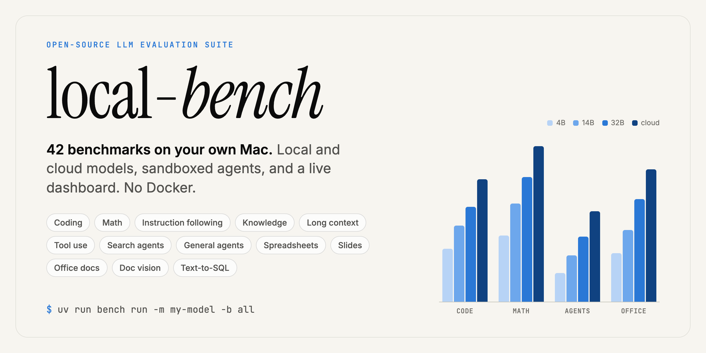
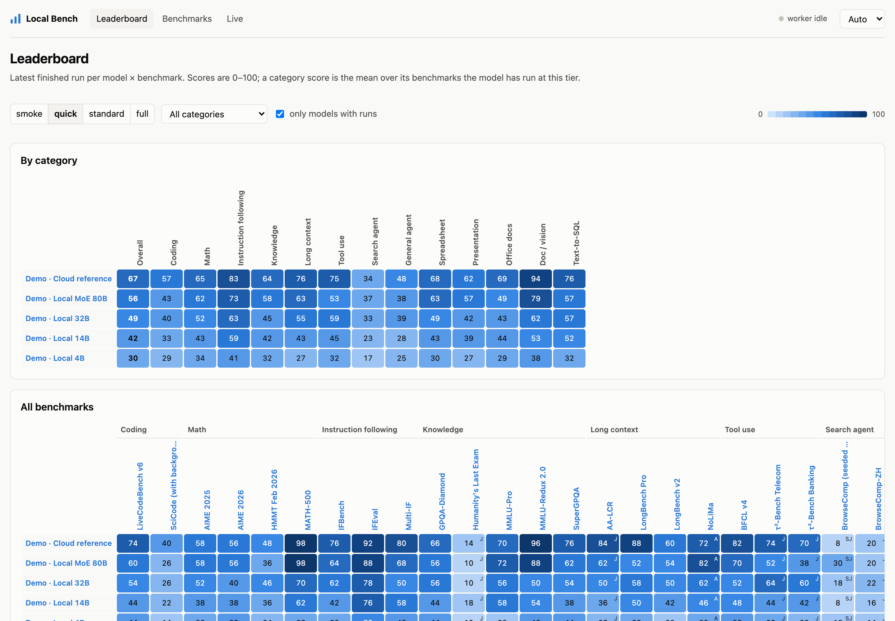
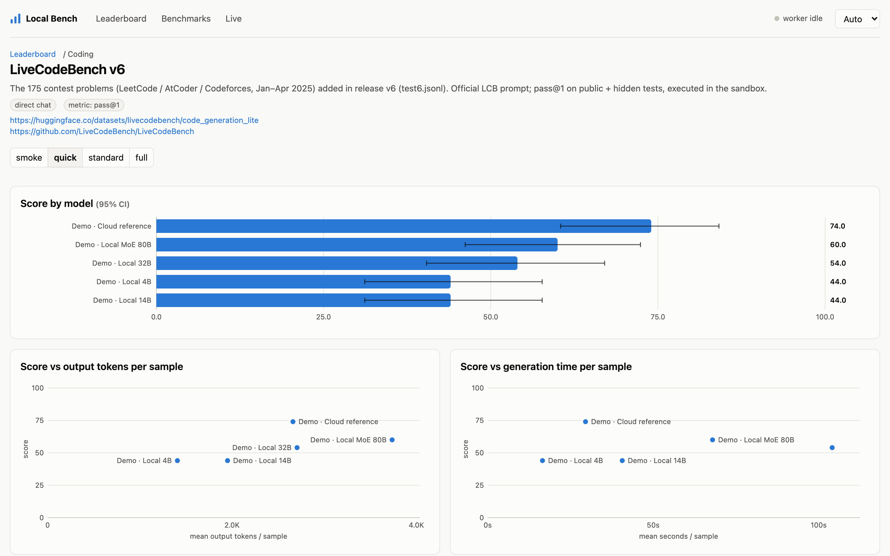
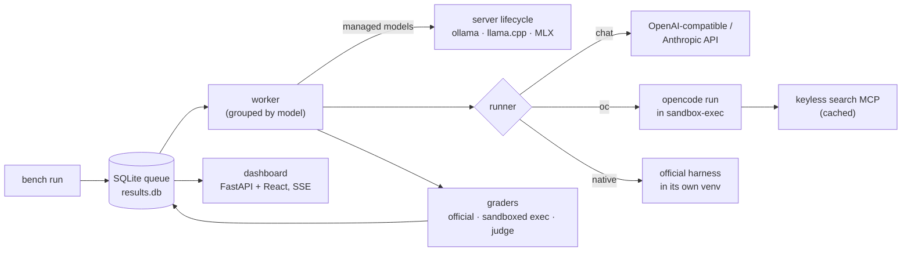

<p align="center">
  
</p>

<p align="center">
  <a href="LICENSE"></a>
  
  
  <a href="docs/BENCHMARKS.md"></a>
  
  <a href="CONTRIBUTING.md"></a>
</p>

<p align="center">
  <b>Benchmark local and cloud LLMs on your own Mac, with one command and a live dashboard.</b><br>
  42 benchmarks across coding, math, knowledge, long context, tool use, agents and office work.
  Model-written code and agents run in a macOS sandbox, so nothing needs Docker.
</p>

<p align="center">
  <a href="#quickstart">Quickstart</a> ·
  <a href="#whats-inside">Benchmarks</a> ·
  <a href="#system-requirements">Requirements</a> ·
  <a href="docs/NEW_BENCHMARK.md">Add a benchmark</a> ·
  <a href="CONTRIBUTING.md">Contributing</a>
</p>

---

## Why local-bench

Published leaderboards rarely cover the quantised model on your laptop, and the official harnesses for
modern evals each need their own setup, Docker images and API glue. **local-bench** puts 42 of them
behind one CLI:

- **Any model.** It can use a server you already run (LM Studio, llama.cpp, mlx_lm, vLLM, …). It can also
  start and stop ollama, llama.cpp or MLX models itself, or call cloud models by API key or through
  [opencode](https://opencode.ai).
- **Same questions for every model.** Subsets are seeded, stratified and frozen in the repo
  (`smoke` 5 / `quick` 50 / `standard` 300 / `full`), so a score from your machine is comparable with
  a score from someone else's.
- **Fair comparisons.** Every score comes with a 95% confidence interval, the tier, a subset hash, the
  harness and the judge model. Adapted harnesses and substitute benchmarks are flagged, never presented
  as the official number.
- **Agents without Docker.** Agentic benchmarks run the model through `opencode run` in a throw-away
  workspace under macOS `sandbox-exec`. The agent can write only to its workspace, can't read secret
  stores, and gets only the network access the task needs. Web search is keyless and cached.
- **Interruptions are safe.** Every sample is saved as soon as it finishes. Stop with Ctrl-C, run the same
  command again, and it continues where it stopped.
- **Live dashboard.** It has a leaderboard heat-matrix, per-benchmark charts with confidence intervals,
  model profiles, a sample-by-sample run explorer with agent transcripts, and live progress.

<picture>
  <source media="(prefers-color-scheme: dark)" srcset="docs/assets/leaderboard-dark.png">
  
</picture>

<p align="center"></p>

<sub>Screenshots use synthetic demo data (`scripts/demo_results.py`). They are not real model results.</sub>

## Quickstart

```bash
git clone https://github.com/shaansundar/local-bench && cd local-bench
uv sync                                   # Python 3.12 env with everything the core suite needs
uv run bench doctor                       # checks optional prerequisites, says what each one unlocks
cp models.example.yaml models.yaml        # then point it at your model (see "Models" below)

uv run bench run -m tiny-qwen-mlx -b math500,ifeval -t smoke   # 10 questions, a couple of minutes
uv run bench serve                        # dashboard at http://127.0.0.1:8765
```

`tiny-qwen-mlx` is a 0.5B model the suite downloads, starts and stops by itself. Run
`uv tool install mlx-lm` first. Once that works, add your real model and run more:

```bash
uv run bench run -m my-model -b Math,Coding -t quick      # categories or slugs
uv run bench run -m my-model,other-model -b all -t smoke  # every benchmark, 5 items each
uv run bench results -t smoke                             # leaderboard in the terminal
```

## What's inside

| Category | Benchmarks |
|---|---|
| Coding | LiveCodeBench v6 · SciCode |
| Math | AIME 2025 · AIME 2026 · HMMT Feb 2026 · MATH-500 |
| Instruction following | IFEval · IFBench · Multi-IF |
| Knowledge | MMLU-Pro · MMLU-Redux 2.0 · SuperGPQA · GPQA-Diamond · Humanity's Last Exam |
| Long context | AA-LCR · NoLiMa · LongBench v2 · LongBench Pro |
| Tool use | BFCL v4 · τ²-Bench Telecom · τ³-Bench Banking |
| Search agent | GAIA (text-only 103) · BrowseComp-ZH · BrowseComp (seeded 100) |
| General agent | GDPval-AA (approx.) · ClawGym-Bench |
| Spreadsheet | SpreadsheetBench (Verified 400) · SpreadsheetBench 2 · WTM-Bench · FRTR-Bench · DataBench |
| Presentation | PPTC · PPTArena · PPTBench |
| Office docs | OfficeComprehensionBench · OfficeQA Pro · OmegaUse-OfficeVal |
| Doc / vision | DocVQA · DUDE · ChartQA |
| Text-to-SQL | BIRD-SQL Mini-Dev · Spider 1.0 |

Each benchmark runs in one of three ways:

- **chat**: a direct OpenAI-compatible call. 29 benchmarks.
- **oc**: an opencode agent in a sandboxed workspace. 8 benchmarks.
- **native**: the official harness, run as a subprocess. 5 benchmarks: τ-bench, BFCL, WTM-Bench and Stirrup for GDPval.

Grading uses the official graders wherever they exist. They are vendored at pinned commits and fetched on
demand.

**[docs/BENCHMARKS.md](docs/BENCHMARKS.md)** lists every benchmark with its metric, sources and
requirements. It also flags each deviation from the official setup:

- **adapted**: the harness differs from the official one.
- **substitute**: stands in for a benchmark that isn't available.
- **partial**: some subsets aren't run.
- **judge**: graded at least partly by an LLM judge.

The same file explains why some popular benchmarks are left out. SWE-bench, Terminal-Bench, OSWorld and
the like need Docker or Windows VMs, and this suite doesn't use either by design.

## System requirements

|  | Minimum | Recommended |
|---|---|---|
| **OS** | macOS with `sandbox-exec` (built in) | macOS 26 Tahoe, the tested release |
| **Chip** | Apple silicon (M1 or newer) | M3/M4 Pro or Max |
| **Memory** | 16 GB: models up to ~8B at 4-bit | 64 GB or more: 27–80B models and 128k-token contexts |
| **Free disk** | 5 GB: core text benchmarks | 60 GB: every dataset, upstream harness and venv |
| **Python** | 3.12 (installed by `uv`) | 3.12 or 3.13 |
| **Network** | Needed to download data; search agents need web access | Fast connection for the first `bench fetch all` |

The suite itself needs about 2–4 GB of RAM for the worker, graders and dashboard. Everything else
belongs to the model. Intel Macs can drive external, ollama or llama.cpp servers, but the MLX launchers
need Apple silicon, and the whole suite is untested on Intel. Linux and Windows aren't supported yet,
because the sandbox is macOS `sandbox-exec`. See [Contributing](CONTRIBUTING.md) if you'd like to add a
backend.

**Required software:** [`uv`](https://docs.astral.sh/uv/) and `git`.

**Optional software.** `bench doctor` checks for each of these and tells you what's missing:

| Tool | Unlocks | Install |
|---|---|---|
| [opencode](https://opencode.ai) ≥ 1.18 | The 8 agentic (**oc**) benchmarks, and opencode-only cloud models | [install guide](https://opencode.ai/docs) |
| mlx-lm / mlx-vlm, ollama or llama.cpp | Models the suite starts and stops itself | `uv tool install mlx-lm`, `brew install ollama`, `brew install llama.cpp` |
| LibreOffice | Formula recalculation (SpreadsheetBench 1/2) and slide rendering (PPTArena) | `brew install --cask libreoffice` |
| Node.js ≥ 18 | Changing the dashboard (`bench serve --build`). A built copy ships in the repo. | `brew install node` |
| Hugging Face account | Gated datasets: GPQA-Diamond, HLE, OfficeQA Pro | `hf auth login`, then accept each dataset's terms |
| A judge model and its API key | Judge-graded benchmarks, and the τ-bench user simulator | See [The judge](#the-judge) |

**How long it takes.** Generation speed sets the pace. Reasoning models write thousands of tokens per
answer.

| Tier | Generations (all 42) | Rough wall time for a 27B reasoning model at ~25 tok/s (M4 Max) |
|---|---|---|
| `smoke` | ~240 | several hours |
| `quick` | ~2,200 | 2–3 days |
| `standard` | ~9,000 | 1–2 weeks |
| `full` | ~90,000 | about two months |

Use tiers to stay within your time budget. Every model sees the same items at a given tier, so `quick`
results are comparable on their own terms.

## Models

Models live in `models.yaml`. It is your own file and is gitignored; start from
[`models.example.yaml`](models.example.yaml). There are three kinds:

```yaml
models:
  my-model:                          # a server you already run
    kind: external
    base_url: http://127.0.0.1:8080/v1
    model_id: my-model
    api_key: local                   # or env:VAR, or opencode:<provider> (read from your opencode config)
    opencode_model: local/my-model   # how opencode addresses it, for agentic benchmarks
    context: 131072
    vision: false
    max_concurrency: 2

  qwen3-30b:                         # started, health-checked and stopped by the suite
    kind: managed
    launcher: mlx_lm                 # ollama | llama_server | mlx_lm | mlx_vlm | command
    model: mlx-community/Qwen3-30B-A3B-4bit
    mem_gb: 18                       # checked against free memory before launch

  claude-opus-5-5:                   # cloud reference (and a good judge)
    kind: cloud
    provider: anthropic              # anthropic | openai (any OpenAI-compatible API) | opencode
    model_id: claude-opus-5-5
    api_key: env:ANTHROPIC_API_KEY
```

- Only one managed model is loaded at a time. The worker groups jobs by model.
- If a model can't take a benchmark (no vision, too little context, no tool calling), the cell shows
  **n/a** instead of a misleading zero.
- **opencode-only models** (`provider: opencode`) are reached only through `opencode run`, authenticated
  by `OPENCODE_API_KEY`. Native harnesses that need a raw API endpoint show as n/a for them.
- API keys go in `.env` (template: [`.env.example`](.env.example)), never in YAML.

## Running

| Command | What it does |
|---|---|
| `bench list` | Benchmarks, categories, runners, badges and whether the data is downloaded |
| `bench models` | Configured models and whether each one is reachable |
| `bench fetch all` | Downloads all the data up front. Otherwise each benchmark's data downloads on its first run. |
| `bench run -m A,B -b <benchmarks> -t <tier>` | Queues the model × benchmark jobs and runs them. Running it again resumes. `--rerun` repeats a finished run; `--new` starts over. |
| `bench worker [--watch]` | Works through the queue. With `--watch` it keeps running as a long-lived worker. |
| `bench status` | The queue and run progress |
| `bench results -t <tier>` | The leaderboard in the terminal |
| `bench regrade --pending \| --errors \| --run ID` | Re-grades stored outputs without generating them again |
| `bench validate <benchmarks>` | Grader self-test: the gold answers must pass and empty answers must fail |
| `bench serve` | The dashboard at http://127.0.0.1:8765 |
| `bench new <slug>` / `bench catalog` | Scaffolds a new benchmark / regenerates the catalog |

`-b` takes `all`, slugs or category names. Press Ctrl-C once to let in-flight samples finish and pause the
run, or twice to force it to stop. For multi-day runs, start the worker detached and keep the Mac awake:

```bash
nohup uv run bench worker > results/worker.log 2>&1 &
caffeinate -i -w $! &
```

## The judge

Free-form answers (HLE, AA-LCR, BrowseComp, GDPval-AA, OfficeComprehension, PPTArena and others) are
graded by **one fixed cloud judge**, so judged scores stay comparable across models and runs. Every
judged score stores the judge's id and prompt version.

To set a judge, add it to `models.yaml`, set `judge.model` in [`config.yaml`](config.yaml), and put its
key in `.env`. Until a judge is set, judge-graded samples are saved as `judge_pending`. Once it is,
`bench regrade --pending` grades them without generating them again. The τ-bench user simulator is the
only part that needs the judge while the run is in progress.

## How it works



Each benchmark is a folder: `benchmarks/<slug>/benchmark.yaml` holds the metadata and requirements,
`adapter.py` implements `fetch / load / build / grade`, and `subsets/` holds the frozen sample lists.
The registry finds new folders automatically, and the CLI, scheduler, dashboard and catalog pick them up
without being registered.

```
bench/               core: config, model clients & server lifecycle, runners, sandbox, judge, worker, CLI, API
benchmarks/<slug>/   one folder per benchmark (benchmark.yaml + adapter.py + frozen subsets)
web/                 dashboard source (Vite + React + TypeScript), built into bench/server/static
scripts/             helper scripts (e.g. synthetic demo data for dashboard work)
docs/                benchmark catalog, new-benchmark guide, assets
data/ vendor/ results/   downloads, pinned upstream harnesses, run outputs (all gitignored)
```

## Security model

Benchmarks run code that a model wrote, and datasets come from the internet, so the suite treats both
as untrusted:

- Model-written code (LiveCodeBench, SciCode, SQL, spreadsheet scripts) runs under `sandbox-exec` with
  CPU, memory and time limits, writes only to a temporary directory, and has no network access.
- opencode agents work in a fresh workspace. Hidden tests and gold files stay out of it while the agent
  works. ClawGym's verifier, for example, is copied in only for grading. Well-known secret stores (`~/.ssh`, `~/.aws`, the `gh` config, …) can't be read, and network
  access is limited to what the task needs.
- Downloaded data is never executed in place. The dashboard is read-only and listens only on
  `127.0.0.1`.

`sandbox-exec` is a macOS sandbox, not a VM. Don't use it to contain models you think are actively
malicious. To report a vulnerability, see [SECURITY.md](SECURITY.md).

## Contributing

Bug reports, fixes and new benchmarks are all welcome. [CONTRIBUTING.md](CONTRIBUTING.md) covers the
development setup, code changes and the acceptance criteria for new benchmarks.
[docs/NEW_BENCHMARK.md](docs/NEW_BENCHMARK.md) is a step-by-step guide to adding a benchmark. It is
written so that a person or a coding agent can follow it from start to finish.

## License

The code is licensed under [MIT](LICENSE). local-bench doesn't redistribute any benchmark data. Each
dataset and upstream harness is downloaded from its original source at run time and stays under its own
license and terms of use. Check them before you publish results. Gated datasets (GPQA, HLE, OfficeQA Pro)
require you to accept their terms yourself.

## Acknowledgements

This suite exists because of the authors of every benchmark listed in
[docs/BENCHMARKS.md](docs/BENCHMARKS.md). Cite their papers when you report numbers. Thanks also to
[opencode](https://opencode.ai), [MLX](https://github.com/ml-explore/mlx),
[llama.cpp](https://github.com/ggml-org/llama.cpp), [ollama](https://ollama.com),
[Math-Verify](https://github.com/huggingface/Math-Verify) and [ddgs](https://github.com/deedy5/ddgs).

If local-bench is useful in your work, please cite it ([CITATION.cff](CITATION.cff)).
